# Session 16: CI/CD & GitHub Actions

**Student:** Prabhav Semwal · **Enrollment:** 24BCS10358

## Demo project

The [Flask application](../app/app.py) serves a dashboard and JSON APIs for health, greeting and arithmetic. [Eight unit tests](../tests/test_app.py) check successful requests and invalid inputs. The [Dockerfile](../Dockerfile) runs Gunicorn as a non-root user. The [workflow](../.github/workflows/devsecops.yml) implements CI and CD for this application.

## CI/CD concepts

| Concept | Use in this project |
| --- | --- |
| CI | Compile the application and run tests on pushes and pull requests |
| CD | Publish the passing image and deploy it to a temporary Kubernetes cluster |
| Workflow | Event-triggered YAML in `.github/workflows/devsecops.yml` |
| Jobs | `ci`, `devsecops` and `evidence`; `needs` sets dependencies |
| Steps | Checkout, setup Python, build, tests, scans, publish and deployment |
| Runner | An Ubuntu hosted machine executes each job |
| Secrets | GitHub supplies `GITHUB_TOKEN` for registry authentication |
| Artifacts | Test coverage, scanner reports, transcripts and rendered screenshots |
| Build | Compile Python source, then build its runnable Docker image |
| Test | pytest validates application behavior; HTTP probes validate deployment |

CI checks each change before delivery. CD uses the tested and scanned image, rather than rebuilding it after the checks. Pull requests execute CI, scans and the Kubernetes smoke test; registry publication runs only for `main` outside pull requests.

## Application build and unit tests

Run from the repository root:

```bash
python3 -m venv .venv
source .venv/bin/activate
pip install -r requirements-dev.txt
python -m compileall -q app
python -m pytest -v --cov=app --cov-report=term-missing --cov-report=xml
docker build -t coursework-devsecops:lab .
docker run --rm -p 5001:5001 coursework-devsecops:lab
```

In another terminal:

```bash
curl -fsS http://localhost:5001/health
curl -fsS -H 'Content-Type: application/json' \
  -d '{"a":4,"b":5,"operation":"multiply"}' \
  http://localhost:5001/api/calculate
```

The health response reports `healthy`; the calculator returns `20`. Gunicorn serves the application inside the container on port 5001.

## Workflow execution, secrets and artifacts

A push to `main`, a pull request or manual **Run workflow** starts the full workflow. The `ci` job compiles the source and runs pytest. The dependent `devsecops` job performs the security checks, Docker build, registry publication and Kubernetes deployment described in [Session 17](../session17/README.md). A failed step stops later delivery steps.

The registry token is passed to `docker login` through standard input and is never printed. Package write permission is granted to the delivery job. The preserved [secrets demo](../.github/workflows/secrets.yaml) is a separate manual exercise: add a repository Actions secret named `DEMO_SECRET` and run that workflow to check its presence without revealing it.

The final `evidence` job collects outputs and renders PNG screenshots into the `hello-cicd-submission-evidence` artifact. It runs even after a failure so the output can be inspected. Screenshots from a failed run are diagnostic evidence; successful pipeline screenshots require both CI and DevSecOps to succeed.

## Recorded execution screenshots

The following screenshots render genuine saved output. The introductory Actions job demonstrates workflow, runner and step execution; it does not include the later build or deployment stages.

### Unit tests

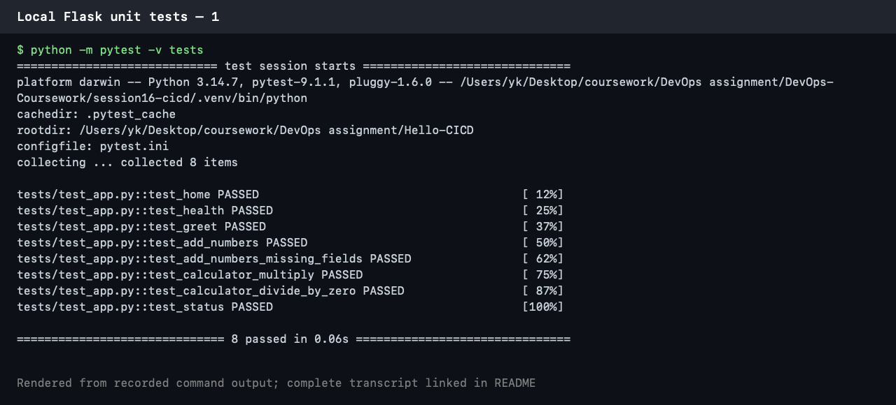

[Complete unit-test transcript](evidence/local-unit-tests.txt)

### Introductory GitHub Actions run

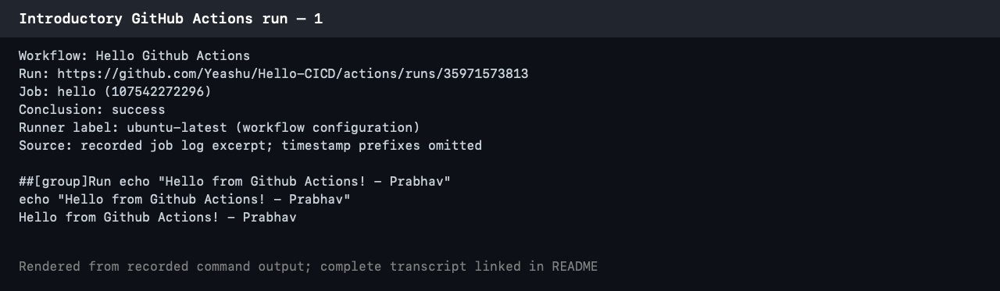

[Run on GitHub](https://github.com/Yeashu/Hello-CICD/actions/runs/35971573813) · [Recorded job output](evidence/intro-actions.txt)

<!-- hosted-evidence:start -->
## Hosted pipeline execution

CI: **success**; DevSecOps: **success**. [Workflow run](https://github.com/Yeashu/Hello-CICD/actions/runs/38614528922).

These PNGs render the saved command output from this run.

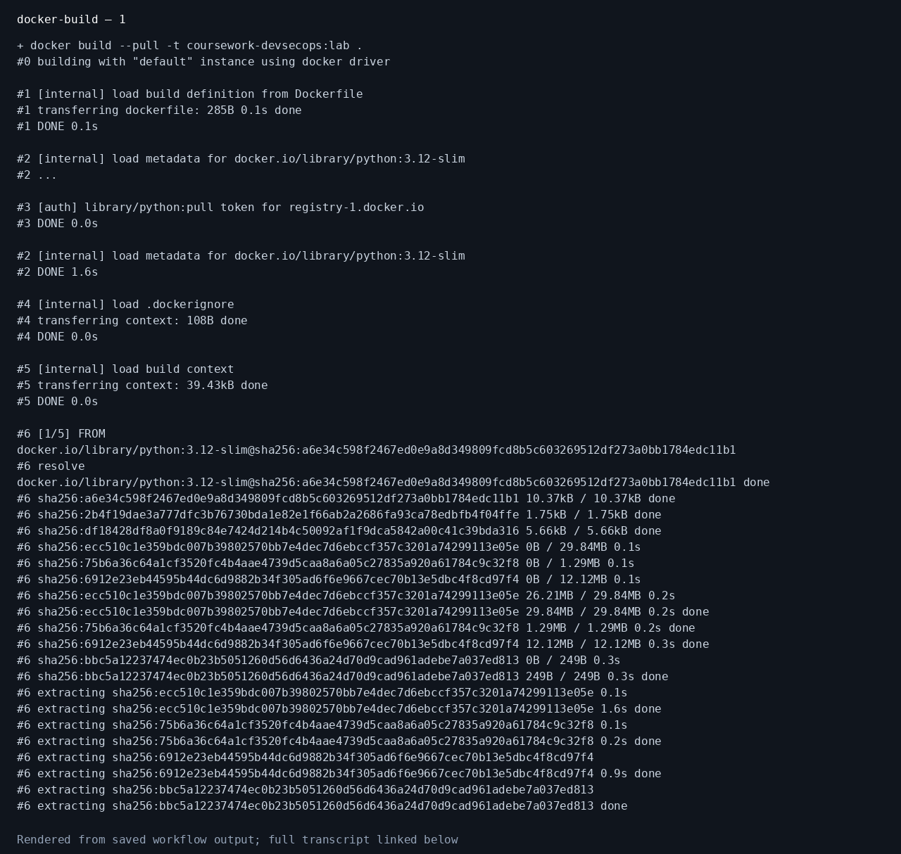


[Complete docker-build output](evidence/docker-build.txt)


[Complete ci output](evidence/ci.txt)

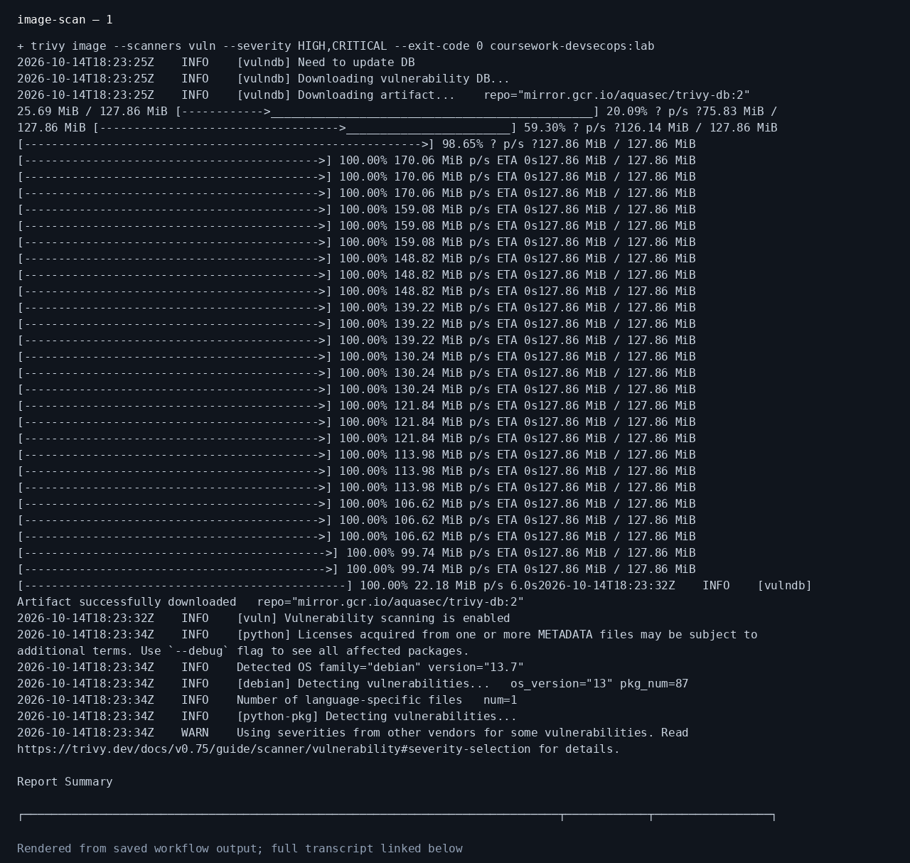

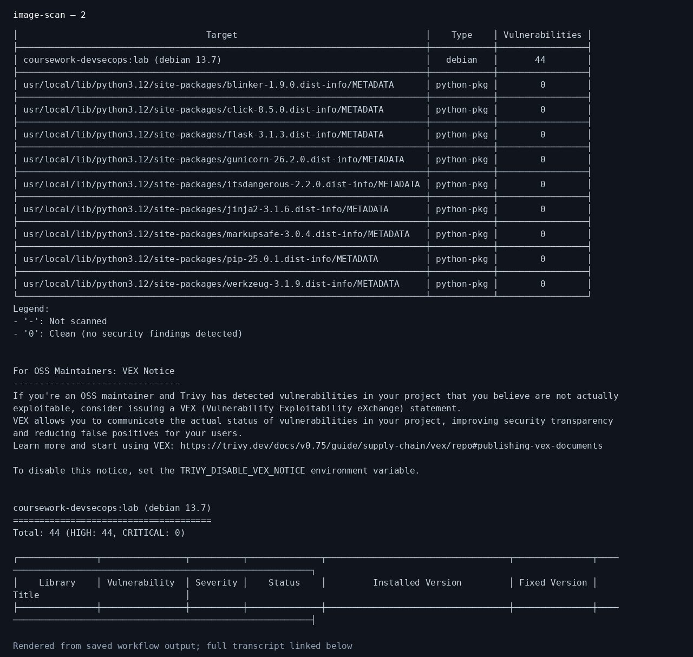


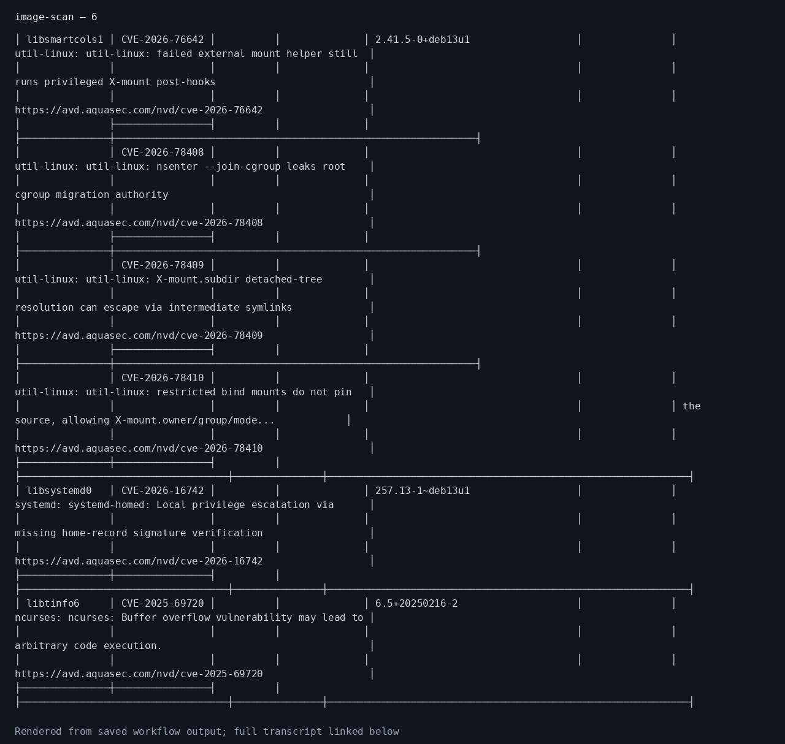


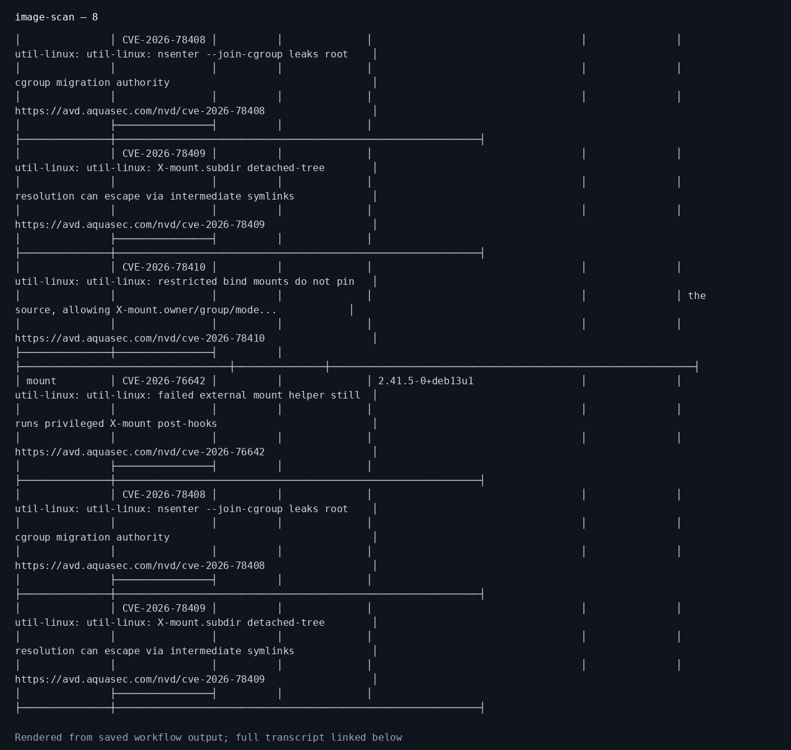

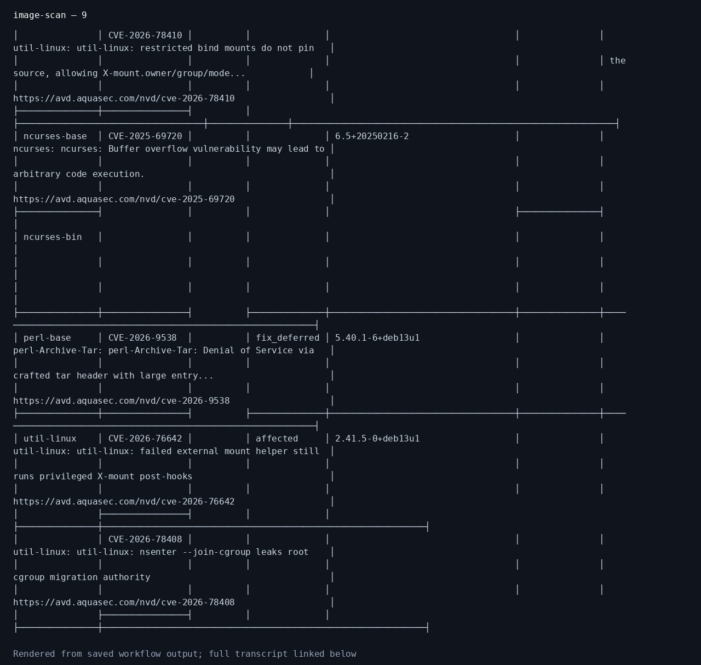

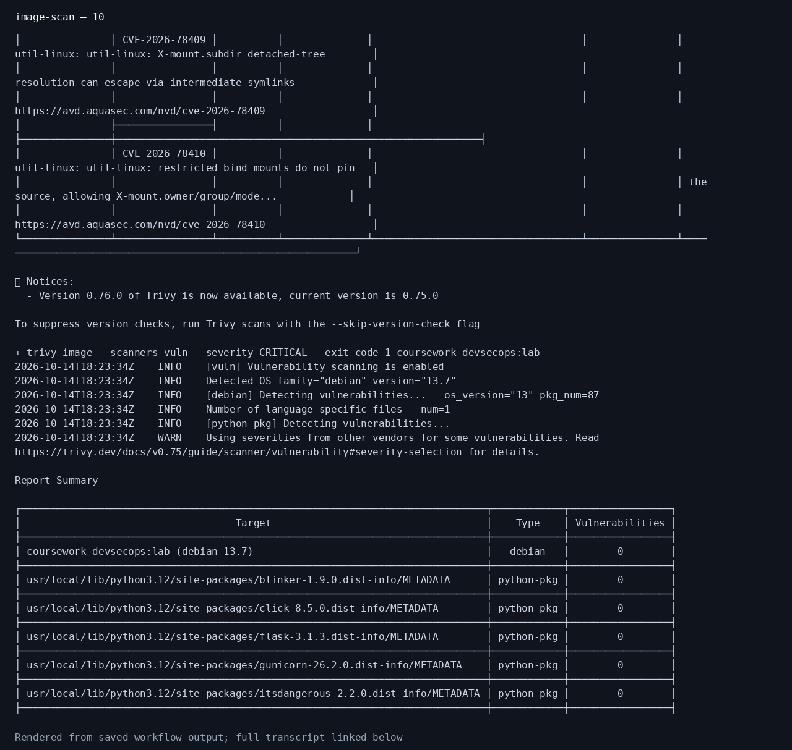

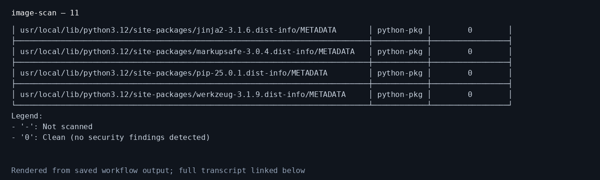

[Complete image-scan output](evidence/image-scan.txt)

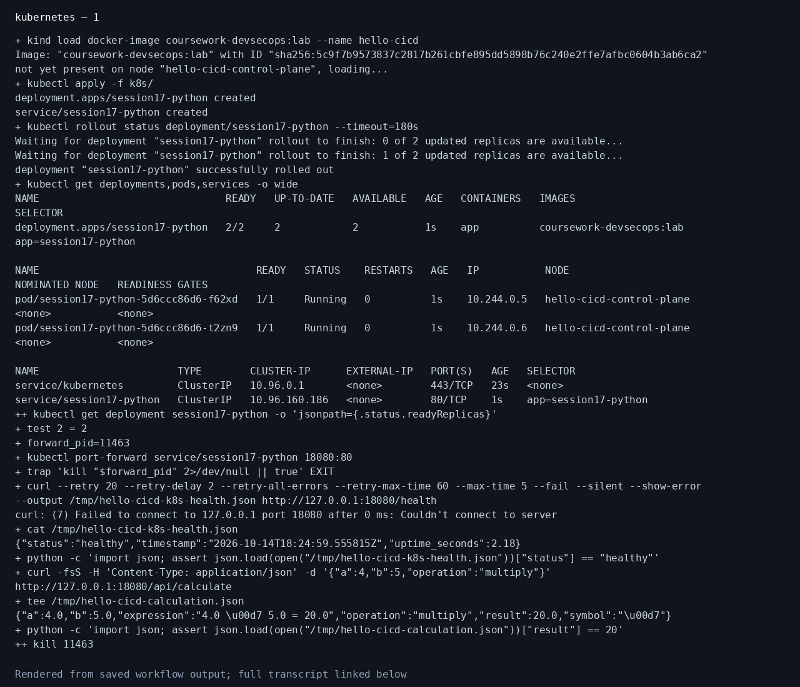

[Complete kubernetes output](evidence/kubernetes.txt)

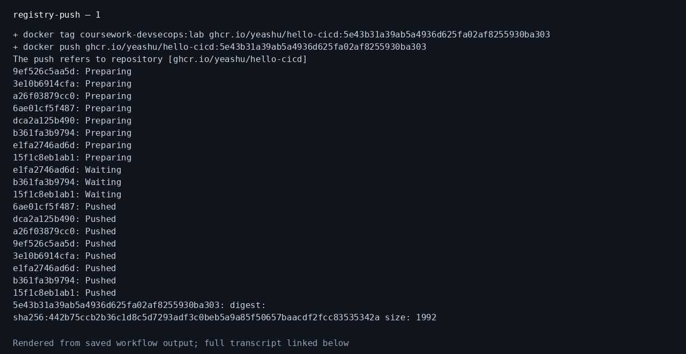

[Complete registry-push output](evidence/registry-push.txt)


[Complete sast output](evidence/sast.txt)

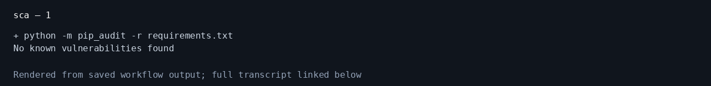

[Complete sca output](evidence/sca.txt)

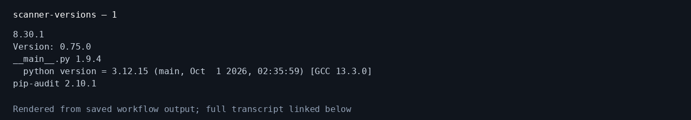

[Complete scanner-versions output](evidence/scanner-versions.txt)


[Complete secret-scan output](evidence/secret-scan.txt)

<!-- hosted-evidence:end -->

## References

[GitHub Actions concepts](https://docs.github.com/en/actions/get-started/understand-github-actions) · [Publishing Docker images](https://docs.github.com/en/actions/tutorials/publish-packages/publish-docker-images)
