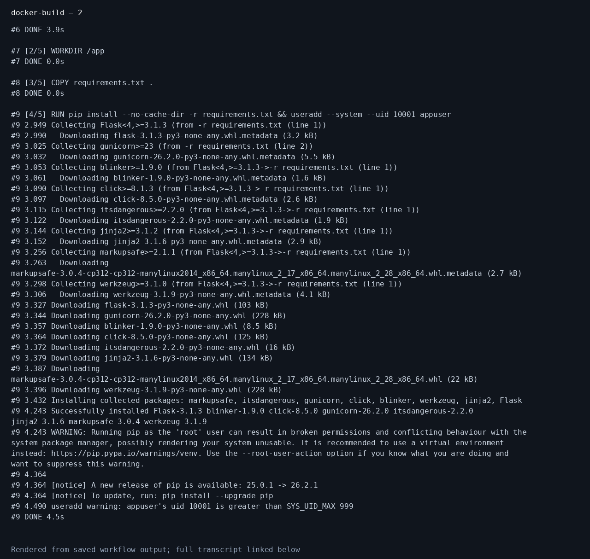
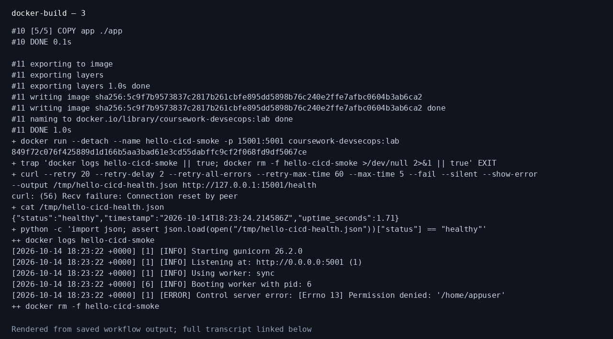
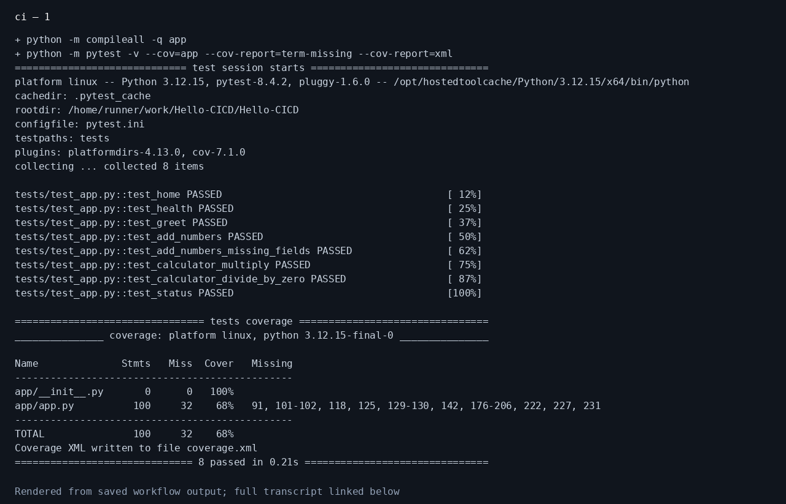
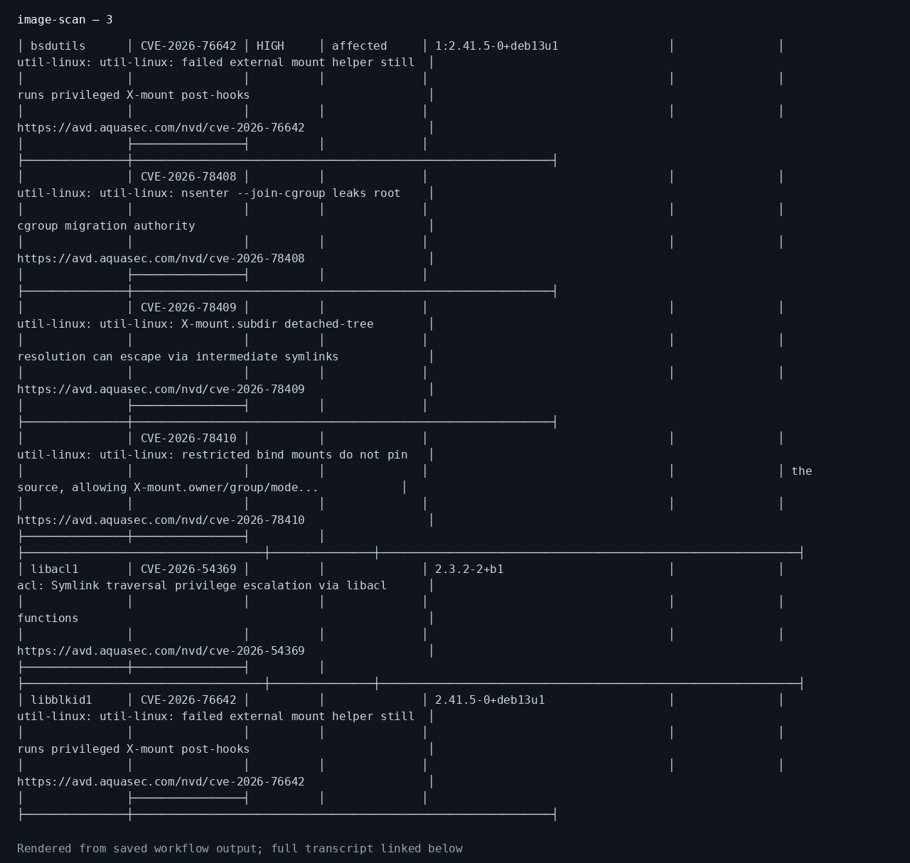
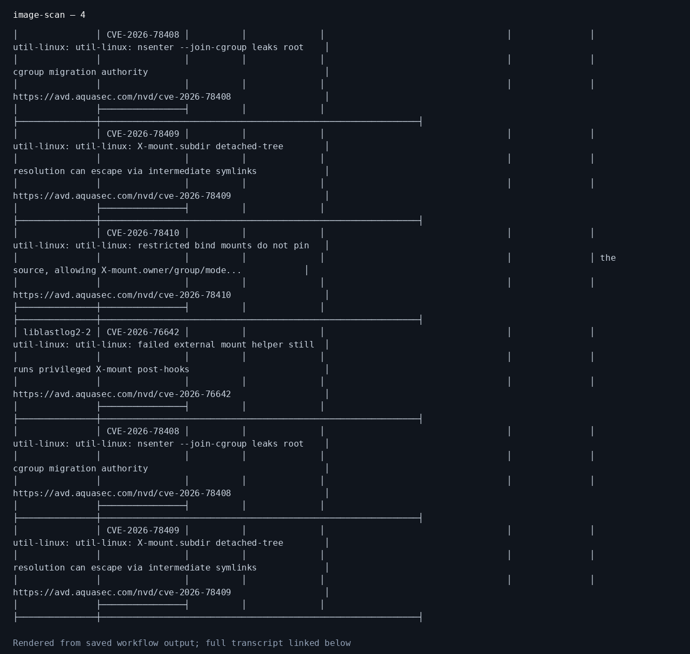
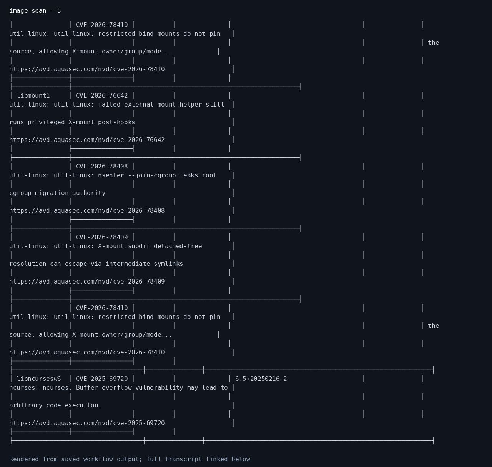
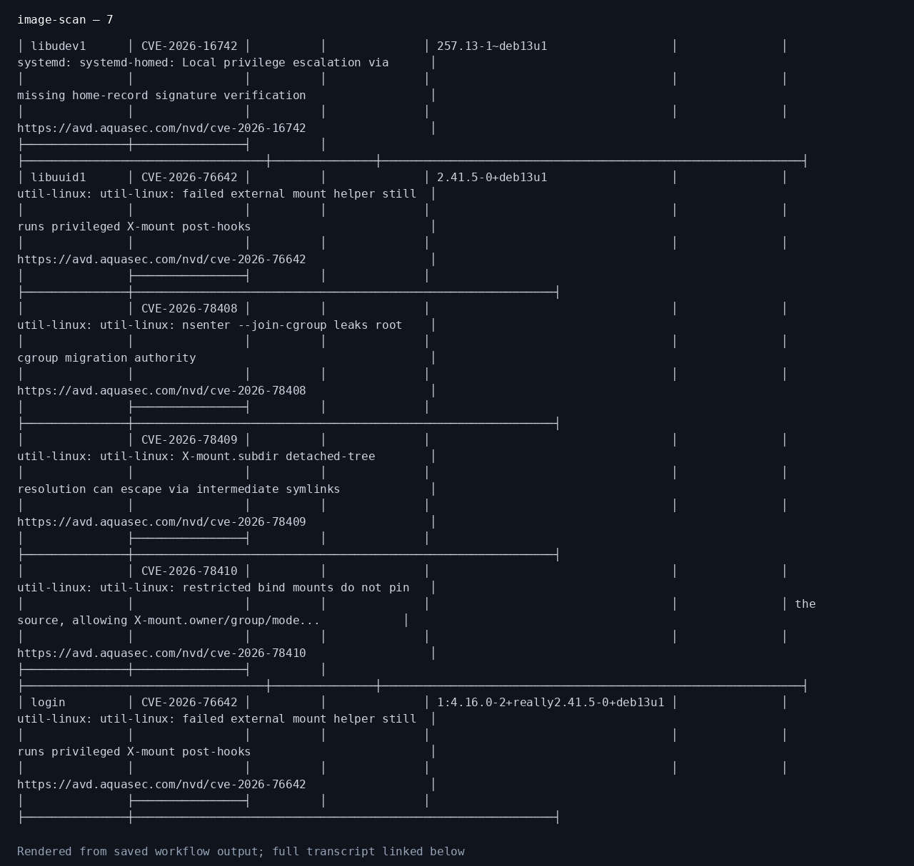
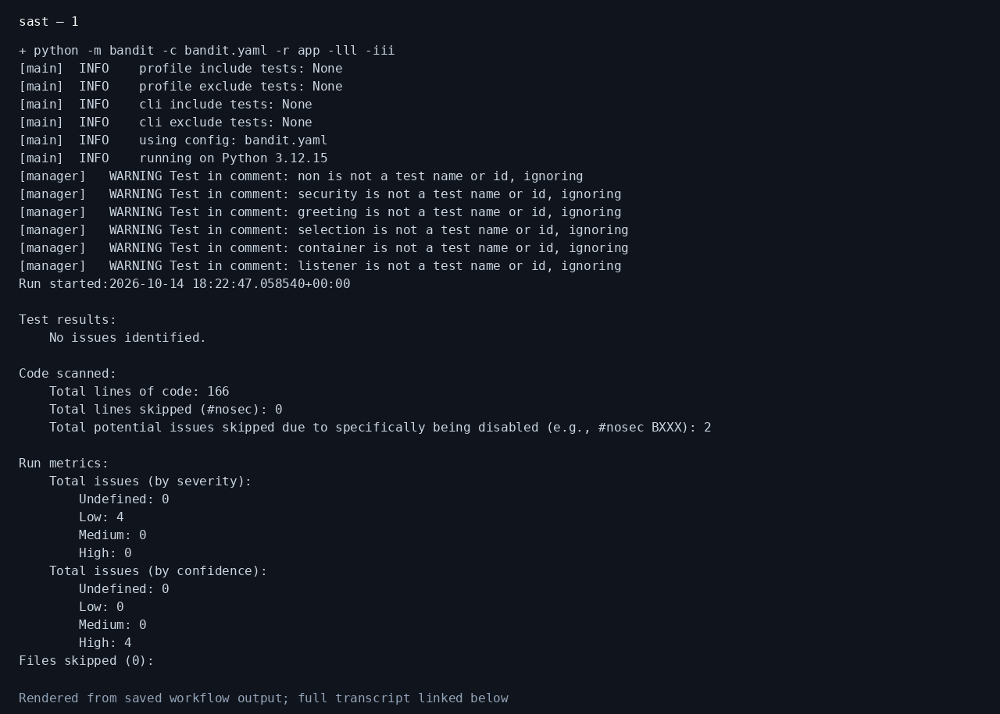
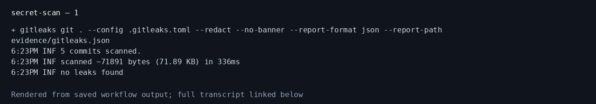

# Session 17: Complete CI/CD & DevSecOps

**Student:** Prabhav Semwal · **Enrollment:** 24BCS10358

## Project and pipeline

The [application](../app/app.py), [tests](../tests/test_app.py), [Dockerfile](../Dockerfile), [workflow](../.github/workflows/devsecops.yml) and [Kubernetes manifests](../k8s/) implement the assignment's delivery flow:

```text
Code → Build → Unit tests → SAST → SCA → Secret scan → Docker build
     → Container image scan → Security gate → Push image → Deploy to Kubernetes
```

Python compilation and tests run in the `ci` job. The dependent `devsecops` job performs the remaining stages sequentially. Security commands run with `set -euo pipefail`, so a nonzero scanner exit prevents image publication and deployment. The `evidence` job collects reports and screenshots even if a gate fails.

## Security tools and configuration

| Check | Tool and configuration | Failure policy |
| --- | --- | --- |
| Unit tests | pytest, [pytest.ini](../pytest.ini) | Any failed test |
| SAST | Bandit, [bandit.yaml](../bandit.yaml) | High-severity, high-confidence findings |
| SCA | pip-audit, [requirements.txt](../requirements.txt) | Any known dependency vulnerability |
| Secret scan | Gitleaks, [.gitleaks.toml](../.gitleaks.toml) | Any detected credential in Git history |
| Container image scan | Trivy, commands in the workflow | Any CRITICAL vulnerability |
| Deployment | Rollout, health and arithmetic probes | Unready deployment or wrong API response |

Trivy records HIGH and CRITICAL findings, then applies the CRITICAL gate to that same built image. The policy is explicit; a passing gate does not mean every possible vulnerability has been eliminated. No scanner uses `continue-on-error` or blanket ignores.

The application's random greeting selection is not a security decision. Its B311 suppression applies only to that line. The B104 suppression documents the container's listening interface. Debug mode is disabled; the container runs with UID 10001 and Kubernetes disables privilege escalation and drops Linux capabilities.

## Run the checks

From the repository root, after installing [development requirements](../requirements-dev.txt):

```bash
python -m compileall -q app
python -m pytest -v --cov=app
python -m bandit -c bandit.yaml -r app -lll -iii
python -m pip_audit -r requirements.txt
gitleaks git . --config .gitleaks.toml --redact --no-banner
docker build -t coursework-devsecops:lab .
trivy image --scanners vuln --severity HIGH,CRITICAL coursework-devsecops:lab
trivy image --scanners vuln --severity CRITICAL --exit-code 1 coursework-devsecops:lab
```

The workflow installs pinned scanner releases and checks their archive checksums. Gitleaks scans the complete checked-out Git history with redacted output; reports never intentionally expose credential values. Bandit and pip-audit scan the production application and its dependencies.

## Container registry

On `main`, the workflow publishes `ghcr.io/yeashu/hello-cicd:<source-commit-sha>` using GitHub's automatic token. The immutable commit tag identifies the source revision. Publication runs after all security gates and a container HTTP smoke test. Pull requests skip publication.

## Kubernetes deployment

The hosted job creates a temporary kind cluster and imports the same tested image directly into it. This avoids requiring public pull access to the GHCR package. The [Deployment](../k8s/deployment.yaml) runs two replicas, sets resource requests and limits, and checks `/health` using readiness and liveness probes. The [Service](../k8s/service.yaml) forwards port 80 to the container's port 5001.

To repeat locally with Minikube:

```bash
minikube start
minikube image load coursework-devsecops:lab
kubectl apply -f k8s/
kubectl rollout status deployment/session17-python --timeout=180s
kubectl get deployments,pods,services
kubectl port-forward service/session17-python 18080:80
```

In another terminal:

```bash
curl -fsS http://localhost:18080/health
curl -fsS -H 'Content-Type: application/json' \
  -d '{"a":4,"b":5,"operation":"multiply"}' \
  http://localhost:18080/api/calculate
```

Expected checks are two ready replicas, a `healthy` response and multiplication result `20`. The hosted workflow verifies these assertions before recording a successful deployment.

## Recorded execution screenshots

This screenshot renders the genuine local unit-test transcript. It establishes application test results; scanner and Kubernetes results come from the hosted workflow.


[Complete unit-test transcript](evidence/local-unit-tests.txt)

<!-- hosted-evidence:start -->
## Hosted pipeline execution

CI: **success**; DevSecOps: **success**. [Workflow run](https://github.com/Yeashu/Hello-CICD/actions/runs/38614528922).

These PNGs render the saved command output from this run.






[Complete docker-build output](evidence/docker-build.txt)



[Complete ci output](evidence/ci.txt)












[Complete image-scan output](evidence/image-scan.txt)


[Complete kubernetes output](evidence/kubernetes.txt)


[Complete registry-push output](evidence/registry-push.txt)



[Complete sast output](evidence/sast.txt)


[Complete sca output](evidence/sca.txt)


[Complete scanner-versions output](evidence/scanner-versions.txt)



[Complete secret-scan output](evidence/secret-scan.txt)

<!-- hosted-evidence:end -->

## References

[Bandit](https://bandit.readthedocs.io/) · [pip-audit](https://github.com/pypa/pip-audit) · [Gitleaks](https://github.com/gitleaks/gitleaks) · [Trivy](https://github.com/aquasecurity/trivy)
